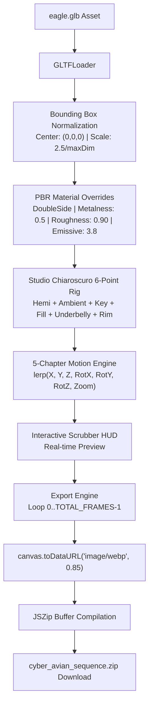

# Cyber Avian Sequence Exporter — Master Course & Architectural Guide

A comprehensive, zero-fluff engineering guide and curriculum detailing the mechanics, lighting architecture, motion choreography, and integration pipeline of [exporter.html](file:///home/drone/eagle-render/exporter.html).

---

## 1. Executive Summary & Core Philosophy

### 1.1 The Production Problem
Embedding real-time 3D models (`.glb` / `.gltf`) directly into client-side production websites introduces severe trade-offs:
- **Variable Framerates:** Low-end mobile devices and integrated GPUs choke on high-poly meshes and complex PBR shaders.
- **Battery & Thermal Throttling:** Running a continuous WebGL render loop drains mobile battery and heats up devices.
- **WebGL Context Crashes:** Mobile browsers kill WebGL contexts aggressively when memory thresholds are exceeded.
- **Large Script Bundles:** Shipping Three.js + loaders + post-processing increases JS bundle weight by 600KB+ minified.

### 1.2 The Industry-Standard Solution: The Frame Sequence Pattern
Pioneered by Apple and leading Awwwards Agency portfolios, the **Frame Sequence Pattern** eliminates runtime 3D calculations entirely:
1. High-fidelity 3D scenes are rendered **offline in the browser** into an image sequence of high-efficiency WebP frames (e.g., 90 to 120 frames).
2. The production website loads a lightweight HTML5 `<canvas>` (0KB 3D runtime overhead).
3. As the visitor scrolls, **GSAP ScrollTrigger** maps scroll distance directly to image indices, drawing each pre-rendered frame onto the canvas at a guaranteed **60–120 FPS**.

[exporter.html](file:///home/drone/eagle-render/exporter.html) is the dedicated studio workstation that automates this entire pipeline: loading the 3D model, applying studio lighting, choreographing multi-chapter camera sweeps, capturing canvas buffers, and packaging the result into a compressed `.zip` archive.

---

## 2. System Architecture & Lifecycle



### Execution Lifecycle
1. **Engine Setup:** Initializes Three.js `WebGLRenderer` (1280x720), `PerspectiveCamera` (36° FOV), and solid slate scene background (`#cfd5dc`).
2. **Lighting Rig Initialization:** Injects 6 balanced light sources providing fill, key highlights, ground bounce, and rim silhouettes.
3. **Model Ingestion & Normalization:** Loads `./eagle.glb`, calculates 3D bounding box dimensions, recenters geometry pivot point to origin `(0,0,0)`, and normalizes scale.
4. **Material Calibration:** Forces two-sided rendering (`DoubleSide`), balances `metalness` and `roughness`, and elevates `emissiveIntensity` to make sensor LEDs glow.
5. **Choreography State Interpolation (`setFrameState`):** Maps normalized progress $t \in [0.0, 1.0]$ across 5 cinematic animation chapters.
6. **Frame Extraction & Archival:** Loops sequentially through each frame, preserves drawing buffers, extracts WebP Base64 strings, bundles them in memory via JSZip, and triggers automatic browser download.

---

## 3. Parameter Reference Matrix ("What Changes What")

### 3.1 Global Render Settings

| Variable | Location | Default Value | Purpose & Visual Impact | How to Tune |
| :--- | :--- | :--- | :--- | :--- |
| `TOTAL_FRAMES` | [exporter.html:141](file:///home/drone/eagle-render/exporter.html#L141) | `90` | Number of discrete frames rendered. 90 frames = ~3.5MB to 4.5MB total ZIP. 120 frames = ultra-smooth scroll. | Increase to `120` for longer scroll tracks; decrease to `60` for ultra-fast mobile payloads. |
| `CANVAS_WIDTH` | [exporter.html:149](file:///home/drone/eagle-render/exporter.html#L149) | `1280` | Render buffer horizontal resolution (720p 16:9). | Set to `1920` for 1080p, or `1080` for mobile 9:16 portrait. |
| `CANVAS_HEIGHT` | [exporter.html:150](file:///home/drone/eagle-render/exporter.html#L150) | `720` | Render buffer vertical resolution. | Set to `1080` for 1080p desktop, or `1920` for mobile. |
| `BG_COLOR` | [exporter.html:157](file:///home/drone/eagle-render/exporter.html#L157) | `0xcfd5dc` | Background color (Hex). Matches Bauhaus Slate base. | Change to match your site's exact background (e.g. `0x0f1115` for dark themes). Eliminates transparency fringing. |
| `toneMapping` | [exporter.html:193](file:///home/drone/eagle-render/exporter.html#L193) | `ACESFilmic` | Mathematical formula compressing high dynamic range colors into screen space. | Prevents metallic specular highlights from clipping into blown-out white blobs. |
| `toneMappingExposure`| [exporter.html:194](file:///home/drone/eagle-render/exporter.html#L194) | `1.5` | Global camera sensor exposure (brightness). | Increase to `1.8`–`2.2` if metallic parts look too dark; lower to `1.2` if washed out. |
| `preserveDrawingBuffer`| [exporter.html:177](file:///home/drone/eagle-render/exporter.html#L177) | `true` | **MANDATORY.** WebGL flag preserving buffer pixels after render. | **Never set to false.** If `false`, `canvas.toDataURL()` captures empty black frames. |

---

### 3.2 Camera Optics

```
        Camera (Z = zoom)
               ▲
               │  Telephoto FOV: 36°
               │  (Reduces perspective distortion)
               │
            [ MODEL ] at Origin (0, 0, 0)
```

| Property | Location | Value | Explanation |
| :--- | :--- | :--- | :--- |
| `fov` | [exporter.html:210](file:///home/drone/eagle-render/exporter.html#L210) | `36` | **Field of View (degrees).** 36° mimics a telephoto/portrait lens. Flattening perspective gives mechanical models an authoritative, architectural look without wide-angle fish-eye warping. |
| `aspect` | [exporter.html:210](file:///home/drone/eagle-render/exporter.html#L210) | `1280 / 720` | Aspect ratio (1.777: 16:9). Matches canvas dimensions. |
| `near` / `far` | [exporter.html:210](file:///home/drone/eagle-render/exporter.html#L210) | `0.1` / `100` | Depth clipping planes. Meshes outside this range are discarded. |
| `camera.position.z` | [exporter.html:475](file:///home/drone/eagle-render/exporter.html#L475) | Dynamic (`zoom`) | Distance from camera to model origin. Lower numbers (e.g. `1.95`) zoom in; higher numbers (e.g. `5.0`) zoom out. |

---

### 3.3 Studio Chiaroscuro 6-Point Lighting Rig

The lighting setup replicates professional automotive studio photography. Rather than a single flat light, 6 distinct fixtures sculpt metallic geometry:

```
                          [Key Light: (6, 4, 7)]
                                 \
                                  \  Intensity: 1.0
                                   ▼
 [Fill Light: (-6, 2, 5)] ---> [ MODEL ] <--- [Underbelly: (0, -6, 2)]
      Intensity: 0.7               ▲               Intensity: 0.5
                                   │
                         [Rim Light: (0, 4, -6)]
                               (Behind)
                            Intensity: 1.4
```

| Light Fixture | Type | Position $(X, Y, Z)$ | Color / Intensity | Visual Role & Rationale |
| :--- | :--- | :--- | :--- | :--- |
| **Hemi Light** | `HemisphereLight` | `(0, 20, 0)` | Sky: `0xffffff`<br>Ground: `0xcfd5dc`<br>Intensity: `0.2` | **Simulates ground bounce.** Standard directional lights leave mechanical undersides pitch black. Ground color matches canvas slate, bouncing soft light upward into chassis seams. |
| **Ambient Fill** | `AmbientLight` | N/A (Omni) | `0xffffff`<br>Intensity: `1.9` | **Base ambient baseline.** Floods all polygons uniformly with zero shadows to ensure internal mechanical joints and ribs remain legible. |
| **Key Light** | `DirectionalLight` | `(6, 4, 7)` | `0xffffff`<br>Intensity: `1.0` | **Primary studio spotlight.** Casts high-angle light from the top-right, creating strong, crisp specular cuts along the upper wing blades and fuselage. |
| **Fill Light** | `DirectionalLight` | `(-6, 2, 5)` | `0xffffff`<br>Intensity: `0.7` | **Shadow softener.** Positioned opposite the Key Light (left side, lower elevation) to prevent the left side of the bird from falling into deep shadow. |
| **Underbelly Light** | `DirectionalLight` | `(0, -6, 2)` | `0xffffff`<br>Intensity: `0.5` | **Talon & piston accent.** Shoots upwards from below to illuminate claws, leg actuators, and tail hydraulics. |
| **Rear Rim Light** | `DirectionalLight` | `(0, 4, -6)` | `0xffffff`<br>Intensity: `1.4` | **Silhouette separator.** Sits behind the model, angled toward the camera. Creates an intense, razor-thin white halo along the wing tips, separating the model cleanly from the grey background. |

---

### 3.4 PBR Material Tuning Loop

Downloaded 3D models (`.glb`) often display black or unnatural surfaces when rendered without an HDRI environment reflection map. Lines [299–335](file:///home/drone/eagle-render/exporter.html#L299-L335) traverse all sub-meshes to enforce calibrated physical material attributes:

```javascript
model.traverse((child) => {
  if (child.isMesh && child.material) {
    child.material.side = THREE.DoubleSide;
    child.material.metalness = 0.5;
    child.material.roughness = 0.90;
    if (child.material.emissive) {
      child.material.emissiveIntensity = 3.8;
    }
  }
});
```

- **`child.material.side = THREE.DoubleSide`**:
  *Why it matters:* Prevents backface culling. Thin geometric parts like wing tips or armor plates disappear when viewed from reverse angles if only front faces are rendered.
- **`metalness = 0.5`**:
  *Why it matters:* Pure metal (`1.0`) relies 100% on reflections. Without an environment map, it reflects an empty void (rendering pitch black). Setting metalness to `0.5` allows diffuse studio lights to illuminate the surface while retaining gunmetal sheen.
- **`roughness = 0.90`**:
  *Why it matters:* Low roughness (`0.1`) creates mirror-sharp reflections. High roughness (`0.90`) disperses light across surfaces like satin/matte anodized aluminum, smoothing out harsh micro-shadows.
- **`emissiveIntensity = 3.8`**:
  *Why it matters:* Multiplies the self-illuminating glow of orange eye sensors, wing LEDs, and engine thrusters, making them pop against the neutral body.

---

### 3.5 Bounding Box Normalization

Different 3D models arrive with arbitrary scale factors (centimeters, meters, inches) and off-center origin points. Lines [343–356](file:///home/drone/eagle-render/exporter.html#L343-L356) guarantee universal calibration:

1. `new THREE.Box3().setFromObject(model)` computes the exact bounding coordinates ($X_{\min}, X_{\max}, Y_{\min}, Y_{\max}, Z_{\min}, Z_{\max}$).
2. `maxDim = Math.max(size.x, size.y, size.z)` detects the largest dimension.
3. `scale = 2.5 / maxDim` rescales the model so it always spans exactly 2.5 Three.js units regardless of original file scale.
4. `model.position.set(-center.x * scale, -center.y * scale, -center.z * scale)` offsets the mesh so its geometric center of mass sits at `(0, 0, 0)`.

---

## 4. Motion Choreography Engine (The 5 Chapters)

The `setFrameState(progress)` function maps the overall progress ($0.0 \le \text{progress} \le 1.0$) into local chapter progress $t$, then linearly interpolates (`THREE.MathUtils.lerp`) coordinates.

### Coordinate Space Reference
- **`targetX`:** Horizontal position. Negative (`-1.35`) = Left, Positive (`+1.45`) = Right.
- **`targetY`:** Vertical position. Negative (`-0.35`) = Down, Positive (`+0.45`) = Up.
- **`targetZ`:** Depth position along Z-axis.
- **`rotX` (Pitch):** Tilts beak up or down. Positive = Beak down / dive; Negative = Beak up / climb.
- **`rotY` (Yaw):** Turns body left or right. Positive = Turn right; Negative = Turn left.
- **`rotZ` (Roll):** Banks wings. Positive = Right wing down; Negative = Left wing down.
- **`zoom`:** Camera Z-distance. Lower (`1.95`) = Macro close-up; Higher (`4.8`) = Wide shot.

```
                           +Y (Up)
                              |
                              |   +Z (Toward Camera)
                              |  /
           -X (Left) -------- (0,0,0) -------- +X (Right)
                            / |
                           /  |
                         -Z   -Y (Down)
```

---

### 4.1 Detailed Chapter Breakdown

#### Chapter 1: Hero Section ($0.00 \to 0.20$)
- **Context:** Top of the landing page. User lands on the hero banner.
- **Choreography:**
  - $X: 0.0 \to 0.1$ (Centered)
  - $Y: -0.05 \to 0.05$ (Subtle hover)
  - $\text{rotX}: -1.00 \to 0.0$ (Transitions from downward tilt to level gaze)
  - $\text{rotY}: 0.0 \to -0.15$ (Subtle yaw turn)
  - $\text{rotZ}: 0.0$
  - $\text{zoom}: 4.4 \to 4.2$ (Wide framing showcasing full wingspan)
- **Visual Goal:** Commanding, imposing frontal hero entrance.

#### Chapter 2: About / Narrative Section ($0.20 \to 0.45$)
- **Context:** User scrolls into two-column layout: text bio on the left, visual on the right.
- **Choreography:**
  - $X: 0.1 \to 1.45$ (Glides over to the right optical third)
  - $Y: 0.05 \to -0.05$
  - $\text{rotX}: 0.18 \to 0.22$
  - $\text{rotY}: -0.15 \to -0.90$ (Turns body sharply to face left toward text)
  - $\text{rotZ}: 0.0 \to -0.18$ (Banks wings diagonally)
  - $\text{zoom}: 4.2 \to 4.0$
- **Visual Goal:** The eagle "looks" directly at the editorial content, guiding reader attention.

#### Chapter 3: Projects Showcase Runway ($0.45 \to 0.70$)
- **Context:** User reaches the project cards / horizontal portfolio track.
- **Choreography:**
  - $X: 1.45 \to -1.35$ (Sweeps across the viewport from right to left)
  - $Y: -0.05 \to -0.35$ (Dips into the lower third)
  - $\text{rotX}: 0.22 \to -0.25$ (Pitches nose and wings upward)
  - $\text{rotY}: -0.90 \to 0.80$ (Flips yaw to face right)
  - $\text{rotZ}: -0.18 \to 0.30$ (Aggressive aerodynamic banking angle)
  - $\text{zoom}: 4.0 \to 4.1$
- **Visual Goal:** Wing blades act as an angled directional launchpad guiding the eye into project cards.

#### Chapter 4: Experience Timeline ($0.70 \to 0.85$)
- **Context:** User reviews chronological career milestone milestones.
- **Choreography:**
  - $X: -1.35 \to 0.0$ (Recenters horizontally)
  - $Y: -0.35 \to 0.45$ (Elevates high into the sky)
  - $\text{rotX}: -0.25 \to 1.25$ (Sharp top-down dive perspective)
  - $\text{rotY}: 0.80 \to 0.0$ (Re-centers yaw)
  - $\text{rotZ}: 0.30 \to 0.0$
  - $\text{zoom}: 4.1 \to 4.8$ (Pulls back to clear vertical space for timeline entries)
- **Visual Goal:** High-altitude vantage point framing timeline data below.

#### Chapter 5: Studies & Credentials ($0.85 \to 1.00$)
- **Context:** Final section / footer call-to-action.
- **Choreography:**
  - $X: 0.0 \to 0.35$ (Slight offset right)
  - $Y: 0.45 \to 0.05$ (Aligns with eye level)
  - $\text{rotX}: 1.25 \to 0.12$ (Resets to horizontal profile)
  - $\text{rotY}: 0.0 \to -0.40$ (Three-quarters inspection angle)
  - $\text{rotZ}: 0.0$
  - $\text{zoom}: 4.8 \to 1.95$ (**Aggressive macro zoom**)
- **Visual Goal:** Intimate close-up inspection highlighting glowing sensor optics, beak joints, and turbine micro-textures.

---

## 5. Step-by-Step Beginner Execution Guide

### Step 1: Run via Local HTTP Server
Browsers block WebGL assets and external `.glb` files when opened directly via `file:///` protocols due to Cross-Origin Resource Sharing (CORS) security policies.

Launch a local web server in your terminal:
```bash
# Using Node / npx (instant, zero installation required)
npx serve .

# OR using Python 3
python3 -m http.server 8000
```
Open your browser at `http://localhost:3000` (or `http://localhost:8000`) and navigate to `exporter.html`.

---

### Step 2: Calibrate Orientation & Center
1. Observe the model on load. If the eagle faces backward, click the **`FLIP 180°`** button.
2. Drag the range scrubber from `0` to `89` to verify that the model stays within the 1280x720 canvas frame throughout all 5 chapters.
3. If the model clips out of view during Chapter 3 or Chapter 5, adjust `zoom` values in [exporter.html:438](file:///home/drone/eagle-render/exporter.html#L438) or [exporter.html:467](file:///home/drone/eagle-render/exporter.html#L467).

---

### Step 3: Match Website Palette & Exposure
1. **Background Color:** Match `BG_COLOR` ([exporter.html:157](file:///home/drone/eagle-render/exporter.html#L157)) and CSS `#viewport-container` ([exporter.html:35](file:///home/drone/eagle-render/exporter.html#L35)) to your web app's background hex code.
2. **Brightness Check:**
   - If the model is too dark or looks like black plastic, raise `renderer.toneMappingExposure` to `1.8`–`2.0` ([exporter.html:194](file:///home/drone/eagle-render/exporter.html#L194)).
   - If surfaces are blown out to pure white, lower exposure to `1.3`.
3. **Accent Glow:** Tune `child.material.emissiveIntensity` ([exporter.html:328](file:///home/drone/eagle-render/exporter.html#L328)) to adjust the neon intensity of the thrusters and sensor eyes.

---

### Step 4: Export the WebP Sequence ZIP
1. Click **`EXPORT WEBP FRAMES (.ZIP)`**.
2. The UI will disable controls and display live progress:
   `Rendering frame X / 90...`
3. JSZip compresses all 90 frames in client RAM and triggers the download: `cyber_avian_sequence.zip`.
4. Unpack the ZIP into your web application's public assets directory:
   ```
   my-web-app/
   └── public/
       └── sequence/
           ├── frame_001.webp
           ├── frame_002.webp
           └── ...
           └── frame_090.webp
   ```

---

### Step 5: Implement in Your Web App (GSAP + Canvas)
Copy and paste this production-grade, zero-dependency pattern into your frontend application:

```html
<!-- index.html -->
<div id="scroll-wrapper" style="height: 500vh; position: relative;">
  <canvas id="sequence-canvas" style="position: sticky; top: 0; width: 100vw; height: 100vh; object-fit: contain;"></canvas>
</div>

<!-- GSAP + ScrollTrigger via CDN -->
<script src="https://cdnjs.cloudflare.com/ajax/libs/gsap/3.12.2/gsap.min.js"></script>
<script src="https://cdnjs.cloudflare.com/ajax/libs/gsap/3.12.2/ScrollTrigger.min.js"></script>

<script>
  gsap.registerPlugin(ScrollTrigger);

  const canvas = document.getElementById("sequence-canvas");
  const ctx = canvas.getContext("2d");
  
  canvas.width = 1280;
  canvas.height = 720;

  const frameCount = 90;
  const currentFrame = (index) => `/sequence/frame_${String(index + 1).padStart(3, '0')}.webp`;

  // Preload all WebP images into memory to guarantee zero stutter
  const images = [];
  const playhead = { frame: 0 };

  for (let i = 0; i < frameCount; i++) {
    const img = new Image();
    img.src = currentFrame(i);
    images.push(img);
  }

  // Draw first frame when ready
  images[0].onload = () => {
    ctx.drawImage(images[0], 0, 0);
  };

  // Bind GSAP ScrollTrigger to the 500vh scroll container
  gsap.to(playhead, {
    frame: frameCount - 1,
    snap: "frame",
    ease: "none",
    scrollTrigger: {
      trigger: "#scroll-wrapper",
      start: "top top",
      end: "bottom bottom",
      scrub: 0.5 // 0.5s smooth scrubbing lag
    },
    onUpdate: () => {
      const img = images[Math.round(playhead.frame)];
      if (img && img.complete) {
        ctx.clearRect(0, 0, canvas.width, canvas.height);
        ctx.drawImage(img, 0, 0);
      }
    }
  });
</script>
```

---

## 6. Code Audits & Synchronization Fixes

In [exporter.html](file:///home/drone/eagle-render/exporter.html), minor discrepancies exist between UI text and underlying logic:

1. **Button Label vs. Constant:**
   - In [exporter.html:126](file:///home/drone/eagle-render/exporter.html#L126), the button reads `EXPORT 120 WEBP FRAMES (.ZIP)`.
   - In [exporter.html:141](file:///home/drone/eagle-render/exporter.html#L141), `TOTAL_FRAMES` is configured to `90`.
   - *Fix:* Synchronize either `TOTAL_FRAMES = 120` or update the button label to `EXPORT 90 WEBP FRAMES (.ZIP)`.
2. **Telemetry Chip Hardcoded String:**
   - In [exporter.html:491](file:///home/drone/eagle-render/exporter.html#L491), the scrubber callback uses a hardcoded `/ 89`:
     ```javascript
     counter.innerText = `FRAME: ${String(frame).padStart(3, '0')} / 89`;
     ```
   - *Fix:* Replace with dynamic template literal:
     ```javascript
     counter.innerText = `FRAME: ${String(frame).padStart(3, '0')} / ${String(TOTAL_FRAMES - 1).padStart(3, '0')}`;
     ```

---

## 7. Enhancement Roadmap (Leveling Up the Studio)

To evolve [exporter.html](file:///home/drone/eagle-render/exporter.html) from a single-purpose utility into an enterprise 3D sequence workstation, implement these modules:

### 7.1 Real-Time GUI Tuning Panel (`lil-gui`)
Add [lil-gui](https://cdn.jsdelivr.net/npm/lil-gui@0.19) to tweak lights, exposure, material roughness, and camera FOV live without reloading code:
```javascript
const gui = new lil.GUI();
const lightFolder = gui.addFolder('Key Light');
lightFolder.add(keyLight, 'intensity', 0, 5, 0.1);
lightFolder.add(keyLight.position, 'x', -10, 10);
lightFolder.add(keyLight.position, 'y', -10, 10);
lightFolder.add(keyLight.position, 'z', -10, 10);

const matFolder = gui.addFolder('Materials');
matFolder.add(child.material, 'metalness', 0, 1, 0.05);
matFolder.add(child.material, 'roughness', 0, 1, 0.05);
```

### 7.2 Image-Based Lighting (HDRI Environment Maps)
Integrate `RGBELoader` to give metallic parts realistic high-contrast studio reflections:
- Metallic gunmetal requires environmental reflections to look tactile.
- An `.hdr` studio lightmap produces photorealistic highlights along curved wing edges.

### 7.3 Real-Time Soft Shadows (`PCFSoftShadowMap`)
Enable shadow casting to ground the eagle in 3D space:
```javascript
renderer.shadowMap.enabled = true;
renderer.shadowMap.type = THREE.PCFSoftShadowMap;
keyLight.castShadow = true;
```

### 7.4 Drag-and-Drop Model Loader
Replace the hardcoded `./eagle.glb` path with a drag-and-drop file zone using HTML5 File API:
- Allows team members to drop any `.glb` or `.gltf` asset directly into the browser viewport to export sequences without editing JavaScript.

### 7.5 OffscreenCanvas & Web Worker Exporting
Currently, frame rendering executes on the main browser UI thread. Using `OffscreenCanvas` inside a dedicated Web Worker allows frames to be generated and compressed in the background at 4x speed without freezing the DOM.

### 7.6 Transparent Alpha Channel Option
Offer a toggle between solid background WebP and transparent WebP / PNG sequences:
- Solid background = smaller file size (~35KB/frame).
- Alpha transparency = permits placement over gradient, video, or patterned website backgrounds.
